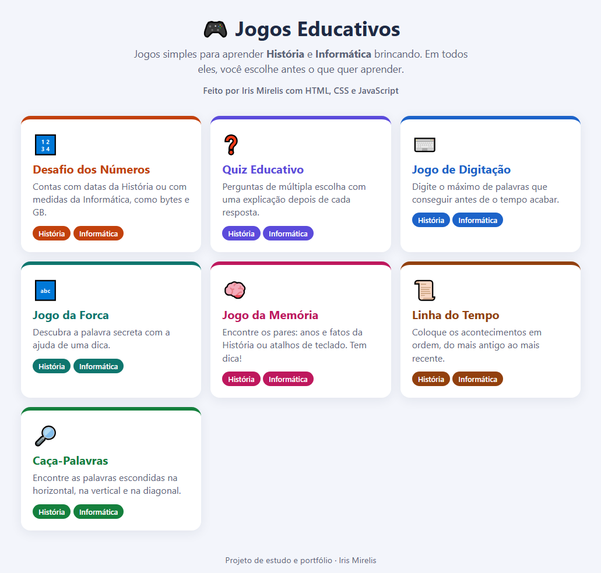

# 🎮 Jogos Educativos

Jogos simples para aprender **História** e **Informática** brincando, feitos com HTML, CSS e JavaScript.

▶️ **[Jogar online](https://irismirelis.github.io/jogos-educativos/)**

## Sobre o projeto
Sou formada em História e estou cursando Análise e Desenvolvimento de Sistemas. No estágio (2020-2021), durante a pandemia, dei aulas para alunos de escola pública e ajudei com computador, internet, Word, Excel, PowerPoint e PDF. Estes jogos são inspirados nessas aulas: fiz para praticar programação juntando as duas coisas, educação e tecnologia.

Em todos os jogos você escolhe antes o que quer aprender: **História** ou **Informática**.

## Jogos
| | Jogo | História | Informática | Repositório só do jogo |
|---|---|---|---|---|
| 🔢 | [Desafio dos Números](desafio-dos-numeros/) | Quantos anos se passaram entre fatos | Bits, bytes, MB e GB | [desafio-dos-numeros](https://github.com/irismirelis/desafio-dos-numeros) |
| ❓ | [Quiz Educativo](quiz/) | Brasil e Egito Antigo | Computador, Office e segurança | [quiz-educativo](https://github.com/irismirelis/quiz-educativo) |
| ⌨️ | [Jogo de Digitação](digitacao/) | Palavras da História | Palavras da Informática | [jogo-de-digitacao](https://github.com/irismirelis/jogo-de-digitacao) |
| 🔤 | [Jogo da Forca](forca/) | Fatos e personagens | Peças e programas | [jogo-da-forca](https://github.com/irismirelis/jogo-da-forca) |
| 🧠 | [Jogo da Memória](memoria/) | Ano e acontecimento | Atalho e o que ele faz | [jogo-da-memoria](https://github.com/irismirelis/jogo-da-memoria) |
| 📜 | [Linha do Tempo](linha-do-tempo/) | História do Brasil | História da Informática | [linha-do-tempo](https://github.com/irismirelis/linha-do-tempo) |
| 🔎 | [Caça-Palavras](caca-palavras/) | Palavras da História | Palavras da Informática | [caca-palavras](https://github.com/irismirelis/caca-palavras) |

Aqui estão todos os jogos juntos, com o menu. Cada um também tem o seu próprio repositório (última coluna).

## Como abrir no computador
1. Clique em **Code > Download ZIP** e descompacte.
2. Abra o `index.html` no navegador. Não precisa instalar nada.

## Organização
Cada jogo tem sua pasta com:
- `index.html`: a estrutura da página
- `style.css`: as cores e o layout
- `script.js`: a lógica do jogo
- `README.md`: a explicação do jogo

## O que eu pratiquei
- **HTML:** botões, formulários e desenho com SVG
- **CSS:** Flexbox, Grid, animações e layout que funciona no celular
- **JavaScript:** eventos, manipulação do DOM, listas e objetos, sorteios, `setTimeout` e `setInterval`

## Autora
Feito por **Iris Mirelis** 💜

