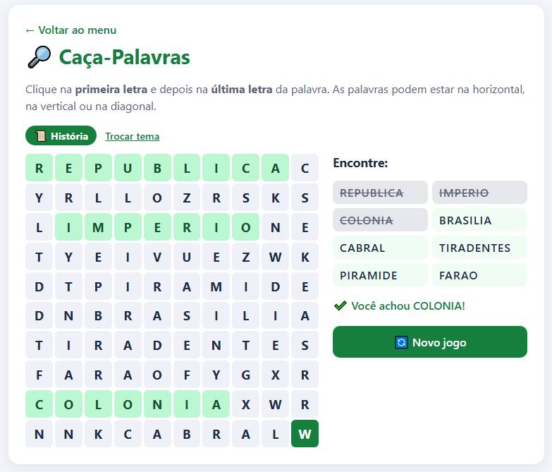

# 🔎 Caça-Palavras

Caça-palavras com palavras de **História** ou **Informática** (você escolhe antes de começar). As palavras são escondidas em lugares sorteados, então a grade muda a cada jogo.

▶️ **[Jogar online](https://irismirelis.github.io/jogos-educativos/caca-palavras/)**

## Como jogar
1. Abra o `index.html` no navegador.
2. Escolha História ou Informática.
3. Clique na primeira letra da palavra e depois na última.
4. Clique em Novo jogo para gerar outra grade.

## Como funciona
1. Para cada palavra, o programa sorteia uma posição e uma direção e confere se ela cabe sem apagar outra palavra.
2. Os espaços vazios recebem letras sorteadas.
3. Quando você clica em duas letras, ele junta as letras do caminho e compara com a lista (também de trás para frente).

## O que eu usei
- Matriz (lista de listas): `grade[linha][coluna]`
- `for` dentro de `for` para percorrer a grade
- CSS Grid para montar a grade na tela

---
Faz parte do projeto [Jogos Educativos](https://github.com/irismirelis/jogos-educativos). Feito por [Iris Mirelis](https://github.com/irismirelis).
