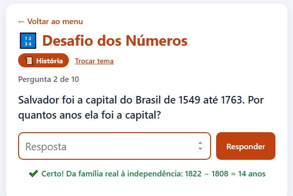

# 🔢 Desafio dos Números

Jogo de perguntas em que a resposta é sempre um número.

Antes de começar você escolhe o tema:
- **História:** quantos anos se passaram entre fatos da História do Brasil.
- **Informática:** contas com bits, bytes, MB e GB e situações do dia a dia, como espaço livre no pendrive.

São 10 perguntas por rodada. Depois de cada resposta aparece a conta, e no final aparecem as que você errou para revisar.

▶️ **[Jogar online](https://irismirelis.github.io/jogos-educativos/desafio-dos-numeros/)**

## Como jogar
1. Abra o `index.html` no navegador.
2. Escolha História ou Informática.
3. Digite a resposta e aperte Enter.

## O que eu usei
- Formulário com `submit` e `preventDefault()`
- Objeto com as perguntas separadas por tema
- Função para embaralhar as perguntas

---
Faz parte do projeto [Jogos Educativos](https://github.com/irismirelis/jogos-educativos). Feito por [Iris Mirelis](https://github.com/irismirelis).
