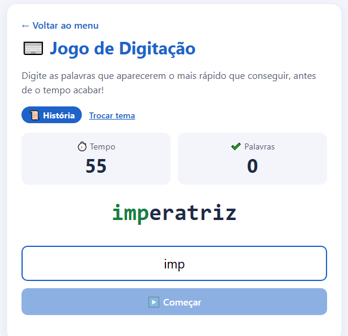

# ⌨️ Jogo de Digitação

Treino de digitação contra o relógio. Antes de começar você escolhe o tema das palavras: **História** ou **Informática**.

Você tem 60 segundos para digitar o máximo de palavras. As letras certas ficam verdes e o campo fica vermelho quando tem letra errada.

▶️ **[Jogar online](https://irismirelis.github.io/jogos-educativos/digitacao/)**

## Como jogar
1. Abra o `index.html` no navegador.
2. Escolha História ou Informática.
3. Clique em Começar e digite a palavra que aparece.

## O que eu usei
- `setInterval` e `clearInterval` para o relógio
- Evento `input` para conferir cada letra
- `startsWith`, `trim` e `toLowerCase` para comparar o texto

---
Faz parte do projeto [Jogos Educativos](https://github.com/irismirelis/jogos-educativos). Feito por [Iris Mirelis](https://github.com/irismirelis).
