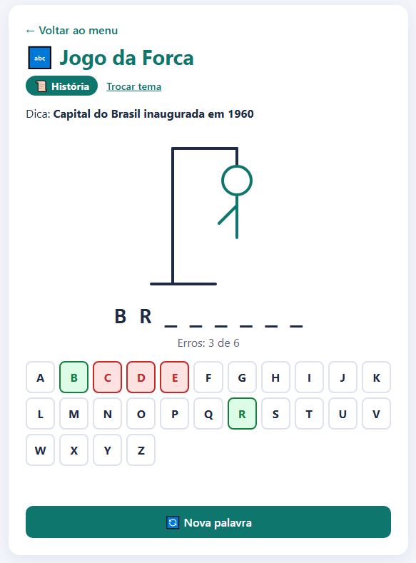

# 🔤 Jogo da Forca

O jogo da forca com palavras de **História** ou **Informática** (você escolhe antes de começar). Cada palavra tem uma dica e dá para errar 6 letras.

▶️ **[Jogar online](https://irismirelis.github.io/jogos-educativos/forca/)**



## Como jogar
1. Abra o `index.html` no navegador.
2. Escolha História ou Informática.
3. Clique nas letras ou use o teclado do computador.
4. Clique em Nova palavra para jogar de novo.

## Como adicionar uma palavra
No `script.js`, coloque uma linha dentro do tema (sem acento e em maiúsculas):
```js
{ palavra: 'QUILOMBO', dica: 'Comunidade formada por pessoas escravizadas que fugiam' },
```

## O que eu usei
- SVG para desenhar a forca
- Evento `keydown` para ler o teclado
- `includes` para conferir as letras

---
Faz parte do projeto [Jogos Educativos](https://github.com/irismirelis/jogos-educativos). Feito por [Iris Mirelis](https://github.com/irismirelis).
