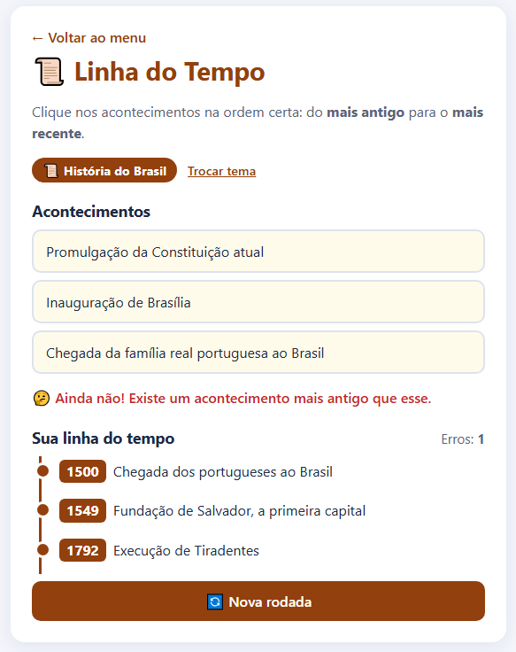

# 📜 Linha do Tempo

Jogo para colocar acontecimentos em ordem, do mais antigo para o mais recente. Antes de começar você escolhe o tema:
- **História:** História do Brasil.
- **Informática:** História da Informática (ENIAC, Windows, internet, Google...).

Em cada rodada aparecem 6 acontecimentos sorteados. Cada acerto entra na linha do tempo com o ano.

▶️ **[Jogar online](https://irismirelis.github.io/jogos-educativos/linha-do-tempo/)**



## Como jogar
1. Abra o `index.html` no navegador.
2. Escolha História ou Informática.
3. Clique primeiro no acontecimento mais antigo, depois no próximo, e assim por diante.

## Como adicionar um acontecimento
No `script.js`, coloque uma linha dentro do tema (o ano não pode repetir):
```js
{ ano: 1932, texto: 'Mulheres conquistam o direito ao voto no Brasil' },
```

## O que eu usei
- `sort` para ordenar pelo ano
- `remove()` para tirar o botão da tela
- Lista `<ol>` criada pelo JavaScript

---
Faz parte do projeto [Jogos Educativos](https://github.com/irismirelis/jogos-educativos). Feito por [Iris Mirelis](https://github.com/irismirelis).
