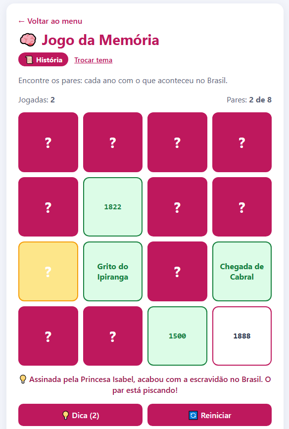

# 🧠 Jogo da Memória

Jogo da memória com dois temas, você escolhe antes de começar:
- **História:** um ano e o que aconteceu no Brasil (ex.: 1888 e Lei Áurea).
- **Informática:** um atalho de teclado e o que ele faz (ex.: Ctrl + C e Copiar).

Quando acha um par aparece uma explicação. Se travar, vire uma carta e clique em **Dica**: aparece uma dica e a carta do par pisca em amarelo. São 3 dicas por jogo.

▶️ **[Jogar online](https://irismirelis.github.io/jogos-educativos/memoria/)**

## Como jogar
1. Abra o `index.html` no navegador.
2. Escolha História ou Informática.
3. Clique em duas cartas. Se for par, ficam verdes. Se não, desviram depois de 1 segundo.

## Pares
| História | | Informática | |
|---|---|---|---|
| 1500 | Chegada de Cabral | Ctrl + C | Copiar |
| 1549 | Salvador vira capital | Ctrl + V | Colar |
| 1808 | Chegada da família real | Ctrl + X | Recortar |
| 1822 | Grito do Ipiranga | Ctrl + Z | Desfazer |
| 1888 | Lei Áurea | Ctrl + P | Imprimir |
| 1889 | Fim do Império | Alt + Tab | Trocar de janela |
| 1932 | Voto feminino | Windows + L | Bloquear o PC |
| 1960 | Brasília vira capital | Windows + E | Abrir pastas e arquivos |

## O que eu usei
- `dataset` para guardar o par de cada carta
- `setTimeout` para desvirar as cartas
- Objeto com os pares separados por tema

---
Faz parte do projeto [Jogos Educativos](https://github.com/irismirelis/jogos-educativos). Feito por [Iris Mirelis](https://github.com/irismirelis).
